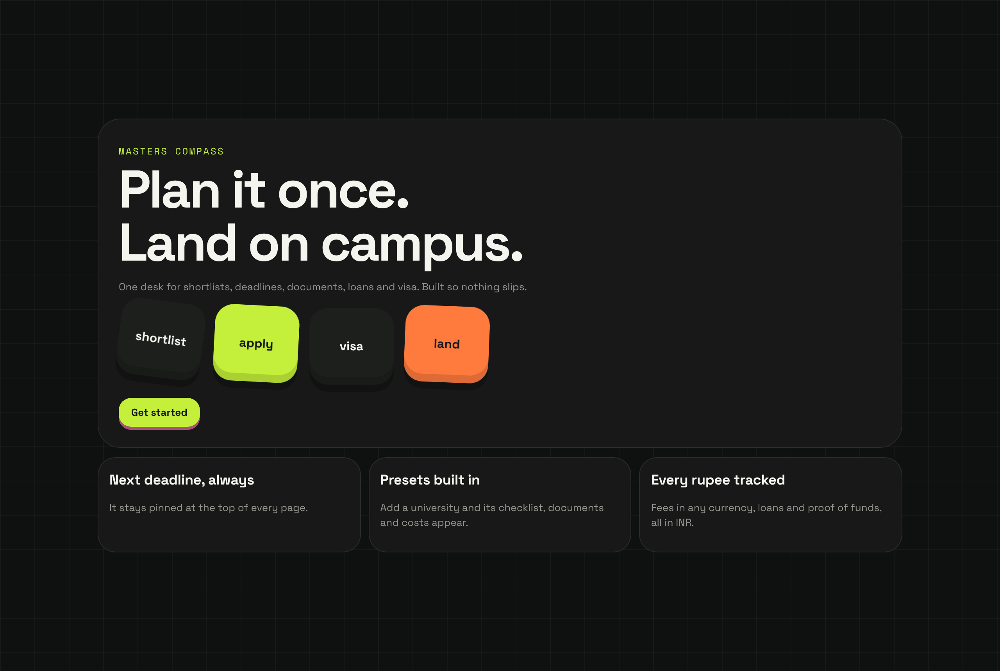
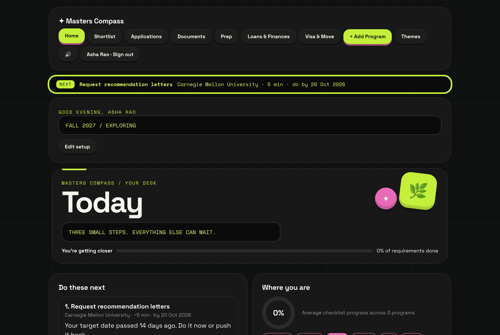
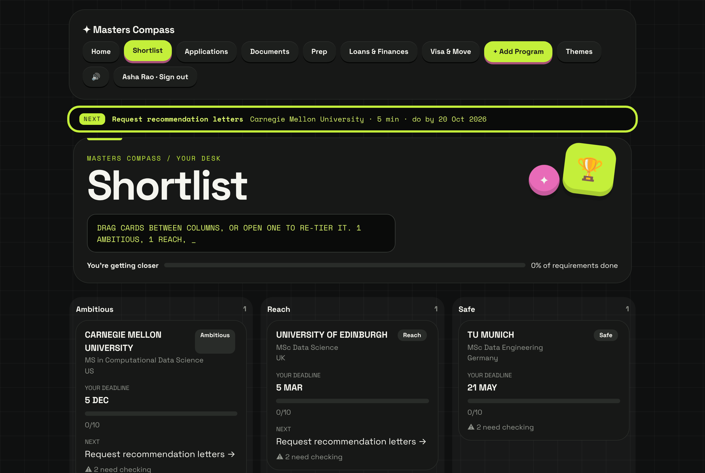
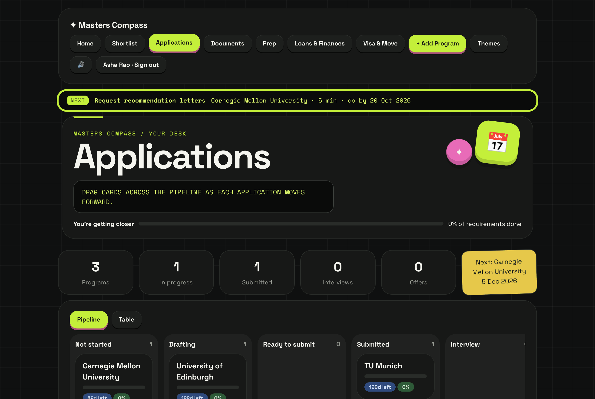
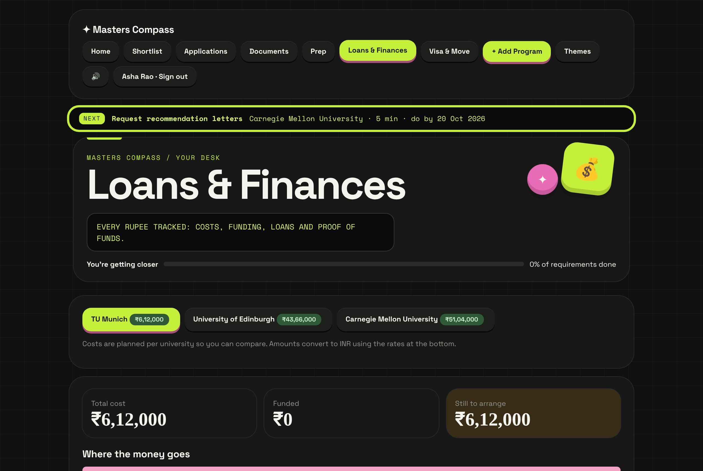
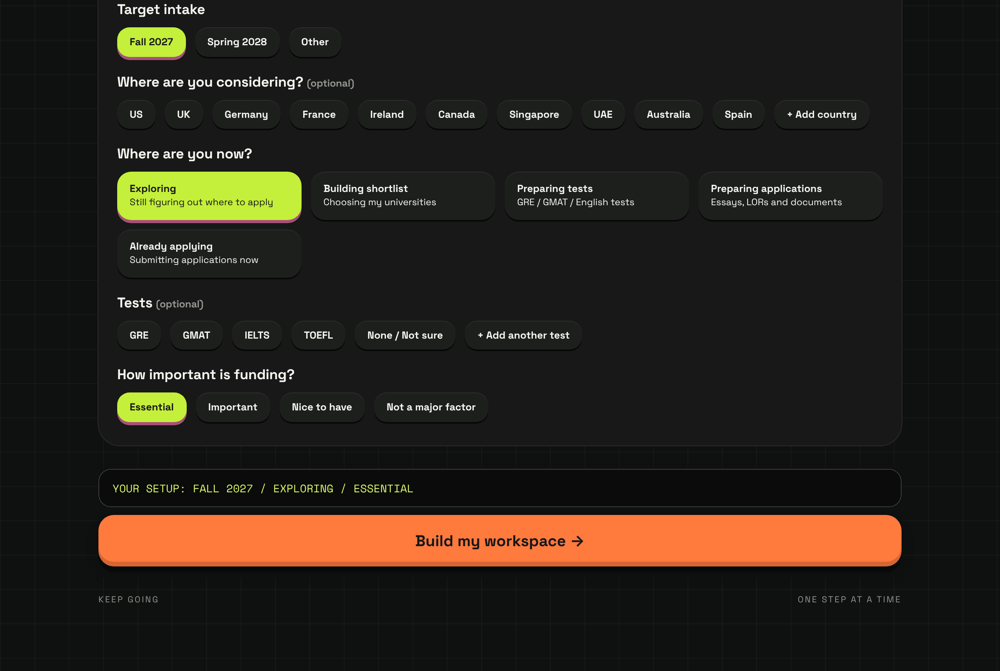
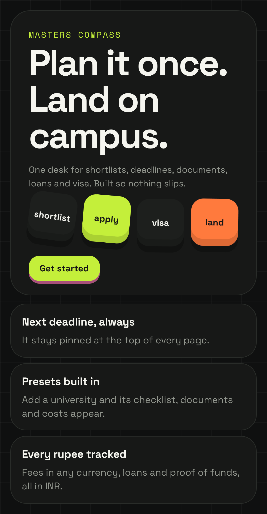

# Masters Compass

**One desk for planning a master's abroad: shortlist, deadlines, documents, loans and visa, so nothing slips.**

Live app: **https://masters-compass.vercel.app**



## The problem

Applying for a master's abroad means juggling 5 to 10 universities, each with its own deadline, fee, test requirements, document list and cost in a different currency. Most applicants, especially students from India funding their degree with loans, track all of this in a mix of spreadsheets, notes apps and browser tabs. Deadlines get missed, recommendation letters are requested too late, and nobody can say what the whole thing will cost in rupees.

Masters Compass puts it all in one place and always tells you the single next thing to do.

## What it does

| | |
|---|---|
| **Next deadline, always** | The most urgent task stays pinned at the top of every page, with a personal buffer date before the official deadline. |
| **Presets built in** | Add a university and its application checklist, document list (SOP, LORs, CV) and cost sheet appear automatically. |
| **Shortlist by tier** | Drag programs between Ambitious, Reach and Safe, and get a nudge if your list has no safe option. |
| **Application pipeline** | A board from Not started to Offer, plus a step-by-step plan for each program. |
| **Every rupee tracked** | Tuition, housing and living costs in any currency, converted to INR, with loan EMI and proof-of-funds calculators. |
| **Visa and move** | Country-specific visa checklists (US, UK, Germany and more) that unlock fully once you accept an offer. |
| **Synced to your account** | Google sign-in, with your workspace saved to Firestore so it works on phone and laptop. |
| **Five themes** | Midnight, Pirate Compass, Nature, Toy Bricks and Pixel Space, each in light and dark. |

<table>
  <tr>
    <td></td>
    <td></td>
  </tr>
  <tr>
    <td></td>
    <td></td>
  </tr>
  <tr>
    <td></td>
    <td align="center"></td>
  </tr>
</table>

## What users asked for

Masters Compass has 12 users so far. Their feedback shaped these features:

<!-- TODO: replace with real quotes from users, e.g.
> "I missed a deadline because I only wrote down the official date." → personal buffer deadlines
-->

- _User feedback quotes to be added._

## Tech

- **Frontend:** plain HTML, CSS and JavaScript, no build step. Hosted on Vercel.
- **Auth and data:** Firebase Authentication (Google) and Cloud Firestore, one document per user at `users/{uid}`.
- **Security:** [`firestore.rules`](firestore.rules) lets each user read and write only their own document. Everything else is denied. Covered by an emulator test.
- **Analytics:** Google Analytics 4 through Firebase Analytics, tracking sign-ups, first university added, return visits and other milestones. See [docs/analytics.md](docs/analytics.md).

```
index.html            page shell and theme bootstrap
css/base.css          layout and components
css/themes.css        the five themes
js/firebase.js        sign-in, Firestore sync, analytics
js/app.js             state, views and event handlers
firestore.rules       database security rules
tests/                rules tests (Firestore emulator)
docs/                 analytics notes and screenshots
```

## Run it locally

```bash
git clone https://github.com/sufiaaa07/masters-compass.git
cd masters-compass
python3 -m http.server 8000     # or any static server
# open http://localhost:8000
```

Google sign-in works on `localhost` because it is an authorised Firebase domain by default.

The Firebase web config in `js/firebase.js` is public by design. Access to data is controlled by the security rules, not by hiding the key.

### Test and deploy the security rules

```bash
npm install
npm run test:rules        # needs Java for the Firestore emulator
npx firebase login
npm run deploy:rules
```
